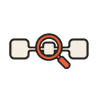
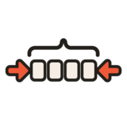

# Skills

A small collection of reusable agent skills for reviewing code, explaining changes, and improving development workflows.

## Common review workflow

For a thorough code review, these three skills are often used as successive passes:

1. **Structural Review** — align the code's overall shape with the domain.
2. **Method Review** — clarify the implementation one method at a time.
3. **Hierarchical Documentation** — polish names and comments before presenting the result.

## Commit Messages

  
  <a href="commit-messages/SKILL.md">View the skill</a> 
  Writes commit messages that explain the context, reasoning, and trade-offs behind a change—not merely the files that changed. Use it to leave future readers a durable narrative of why a decision was made.

 

## Diff Explainer

  
  <a href="diff-explainer/SKILL.md">View the skill</a> 
  Turns a Git diff into an interactive, reader-specific HTML walkthrough with concise teaching notes linked to relevant lines. Use it to understand or explain an unfamiliar change, especially when the language, framework, or project conventions are new to the reader.

 

## Structural Review

  
  <a href="structural-review/SKILL.md">View the skill</a> 
  Evaluates whether code structure matches the problem domain by naming concepts, finding leaky abstractions, and comparing alternative framings. Use it when an implementation feels awkward at a deeper level than method cleanup and you want to reconsider the model or overall approach. It is usually the first of the three review passes.

 

## Method Review

  
  <a href="method-review/SKILL.md">View the skill</a> 
  Reviews individual methods for clarity, with attention to decomposition, conditionals, boolean logic, and unnecessary machinery. Use it after Structural Review to improve local control flow without losing sight of the larger design.

 

## Hierarchical Documentation

  
  <a href="hierarchical-documentation/SKILL.md">View the skill</a> 
  Polishes names and comments so information lives at the most useful level of the code before human review. Use it as the final pass, after Structural Review and Method Review, to prepare the result for someone else.

 

## Pentest

  
  <a href="pentest/SKILL.md">View the skill</a> 
  Security-audits a user-specified subsystem by using adversarial RSpec request specs to probe authorization and data-exposure boundaries. Use it when you want executable evidence of vulnerabilities, plus a report of confirmed risks and verified defenses, rather than a purely speculative review.

 

## Retro

  
  <a href="retro/SKILL.md">View the skill</a> 
  Examines a coding session for moments when a human had to intervene, then proposes concrete improvements such as hooks, generators, verifiers, connectors, or new skills. Use it after a long or friction-heavy session to turn recurring pain into durable automation.

 

## Defrag

  
  <a href="defrag/SKILL.md">View the skill</a> 
  Charts Claude Code and Codex sessions as bars of agent runs cut by stops, the moments you had to act. Each run is coloured by what it was for, forced stops (permission prompts, logins, interrupts) stand out in red, and named patterns like "interview" or "rework tail" are bracketed above the bar from a vocabulary that persists between reports. Claude's own read comes separately, with guidance, skills, scripts, verification or access changes. Use it across a week or two of sessions to find why work keeps blocking on you. It's a sibling of Retro: Retro looks deep into one session, Defrag looks for patterns across many.

 
